# Blind Under Load

**Measuring Suricata detection loss under stream memory exhaustion using the GeNIS 2025 enterprise intrusion dataset**

CMSC 5323 Network Security, University of Central Oklahoma, Fall 2026. Author: Amit Soni.

Suricata keeps every TCP session and its reassembled byte stream in two memory pools with fixed limits,
`stream.memcap` (sessions) and `stream.reassembly.memcap` (reassembly). When a pool is full, Suricata applies an
exception policy and keeps running, so any detection it loses is lost silently. This project measures that loss on
real enterprise attack traffic, explains which traffic is hit and why, and turns the measurements into a simple
sizing rule.

## Results at a glance

1. **Suricata's default limits lost no alert** on any of the 8 captures, even with a flood running beside another attack.
2. **Alerts were lost only when a memory limit was actually reached.** Over 468 constrained runs, 0 of the 284 that
   never reached a limit lost alerts, against 175 of the 184 that did (Fisher's exact test, p < 10^-100).
3. **`ignore` is the best exception policy under exhaustion.** SMB brute force at the smallest level kept 76.9-77.6 %
   of its attacker-victim alerts with `ignore`, against 16.9-25.4 % with every other policy.
4. **The two pools protect different detections.** The session limit removes Suricata's built-in TCP checks; the
   reassembly limit removes the content rules.
5. **A flood can hide a second attack below the defaults.** SSH brute force under the Hulk flood lost alerts in 4 of 4
   runs at L3, and in 0 of 3 runs alone (p = 0.029).
6. **Memory demand is predictable.** The peak number of sessions Suricata holds decides where loss begins, and
   **1 KB of `stream.memcap` per held session** kept at least 99.97 % of alerts in 15 of 15 test runs on five
   different attacks. Every capture fit in 128 MB of reassembly memory, half the default.
7. **The conclusions hold multi-threaded and with a second alert key**, and the key results reproduce on a newly
   installed machine with one script.

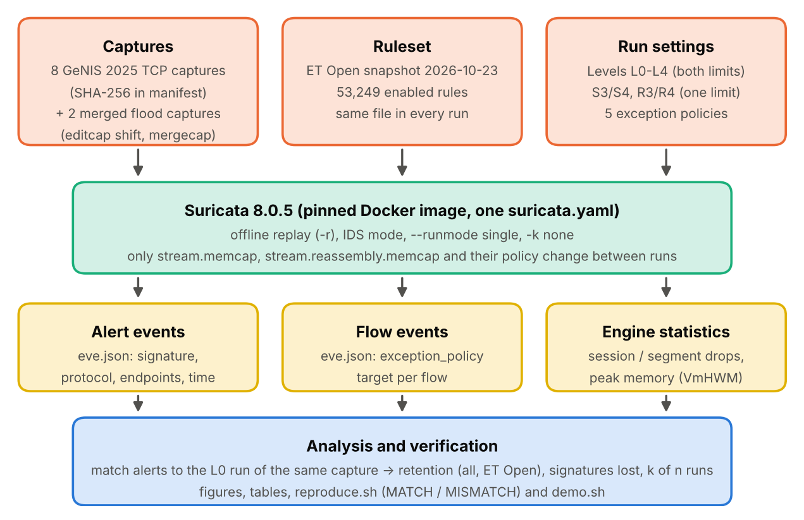

*Workflow: the captures, the pinned Suricata image, the ruleset and the configuration are fixed; only the memory
limits, the exception policy and the run mode change between runs. Every run writes its own folder.*

---

## 1. The problem

A network IDS can only alert on traffic it has inspected. When Suricata's stream memory runs out, it does not stop or
warn the analyst; it applies an exception policy and some traffic is no longer fully inspected. The traffic that fills
these pools is often attack traffic: an HTTP flood opens tens of thousands of connections, each needing session and
reassembly memory. A flood can therefore attack its target and blind the sensor watching it at the same time.
Smaller organisations often run Suricata on modest hardware and lower these limits to fit, without knowing what it
costs in detection. This project answers six questions:

| | Question |
|---|---|
| RQ1 | How does alert retention change as both limits shrink, and where does loss begin for each kind of traffic? |
| RQ2 | Once memory is exhausted, how do the five exception policies change what is still detected? |
| RQ3 | Which of the two pools causes which loss? |
| RQ4 | Does a DoS flood hide the alerts of a second, concurrent attack? |
| RQ5 | Can the safe memory limit be predicted from the traffic? |
| RQ6 | Do the findings hold when Suricata runs multi-threaded? |

## 2. Setup and why each choice was made

| Item | Choice | Why |
|---|---|---|
| Engine | Suricata 8.0.5, Docker image `jasonish/suricata:8.0.5` pinned by digest (`docs/image_digest.txt`) | Every run uses the identical binary |
| Replay | Offline (`-r`), `--runmode single`, `-k none` | Offline reading never drops packets, so any loss comes from memory alone; one thread removes scheduling noise (Experiment F then checks multi-threaded) |
| Rules | ET Open snapshot of 2026-10-23, 53,249 enabled rules, SHA-256 in `docs/ruleset.txt` | ET Open changes daily; a fixed snapshot keeps alerts comparable |
| Data | 8 TCP captures from GeNIS 2025 (Zenodo record 14919237): 5 attacks, 3 benign, 2,141,519 packets, 677.8 MB | Recent, well-documented enterprise dataset with raw captures; TCP because the study is about TCP stream memory |
| Ground truth | Each capture's own run at L0 (1 GB / 4 GB) | Label-independent: no dataset label errors can leak in |
| Memory levels | L0 1 GB / 4 GB, L1 64 / 256 MB (Suricata default), L2 16 / 64 MB, L3 4 / 16 MB, L4 1 / 4 MB | A factor of four per step, starting at the defaults |
| Separate limits | S3, S4: only `stream.memcap` tight; R3, R4: only `stream.reassembly.memcap` tight | Isolates the cause of each loss (RQ3) |
| Exception policies | `ignore`, `drop-packet`, `drop-flow`, `pass-flow`, `bypass` | All policies Suricata offers for these limits |
| Fixed pools | `flow.memcap` 1 GB, `defrag.memcap` 256 MB | Only stream memory is varied |

**Captures**

| Capture | Role | Packets | TCP sessions | Alerts at L0 |
|---|---|---|---|---|
| attack-dos-hulk | HTTP flood | 586,843 | 50,823 | 6,116 |
| attack-dos-slowloris | Slow HTTP DoS | 701,787 | 17,315 | 285 |
| attack-bruteforce-ssh | Brute force | 88,342 | 4,234 | 644 |
| attack-bruteforce-ssh-ftp | Brute force | 213,806 | 14,324 | 5,963 |
| attack-bruteforce-smb | Brute force | 112,746 | 11,989 | 1,046 |
| benign-admin-activity | Benign | 8,908 | 35 | 6 |
| benign-background-activity | Benign | 112,184 | 239 | 1 |
| benign-user-activity | Benign | 316,903 | 1,452 | 80 |

## 3. How a run is measured

1. `scripts/06_run.sh` starts the pinned container on one capture with one memory setting and one exception policy,
   records the command line, the console output, `stats.log`, a compressed `eve.json` (alert, flow and stats events)
   and the peak resident memory of the Suricata process.
2. **Alert retention** is the share of the capture's L0 alerts that the run raises again. Alerts are matched one by
   one, not counted, because under memory pressure Suricata raises different alerts in place of the lost ones (Hulk with
   only 64 MB of reassembly memory raised 7,142 alerts against 6,116 at L0, yet matched only 91.3 % of them).
3. **Two alert keys.** The *endpoint key* (signature, protocol, source, destination, destination port) is the strict
   one used for the main grid. The *host-pair key* (signature, protocol, source, destination) handles thresholded rules:
   SMB's main rule (SID 2102924, 998 of 1,046 alerts) fires on every tenth failed logon, and under memory pressure that
   tenth logon can fall in another session of the same attacker, so the alert survives with a different client port.
   Every run is scored with both keys (`results/key_sensitivity.csv`).
4. **Loss** means retention below 99.9 %. L0 runs are deterministic (largest difference 5 of 5,963 alerts, 0.08 %),
   so this threshold sits above the noise.
5. **Memory limit reached** is read from the per-flow `exception_policy` records in `eve.json`, which catch cases the
   classic drop counters miss.
6. Runs near a limit vary, so every such configuration was repeated and is reported as "lost in k of n runs".

## 4. Results walkthrough

### 4.1 The defaults are safe; loss starts where memory demand is highest (RQ1)

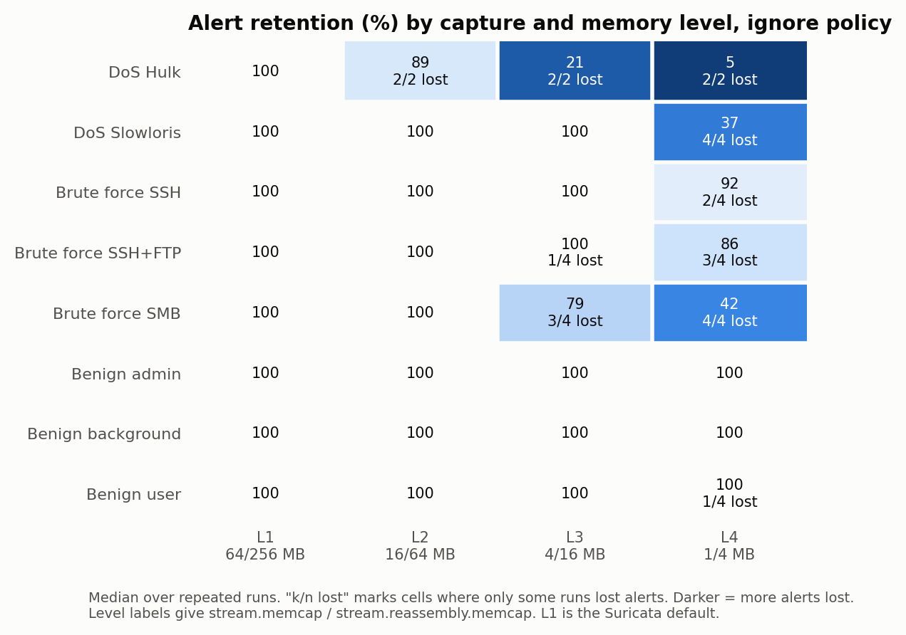

At L1, the Suricata defaults, every capture kept every alert. Below them, the HTTP flood lost first (89 % at L2,
21 % at L3, 4.6 % at L4, where 10 of its 22 signatures stopped firing), then the brute-force attacks, then Slowloris
and SSH at L4. The benign admin and background captures never lost an alert.

### 4.2 Alerts are lost only when a limit is reached

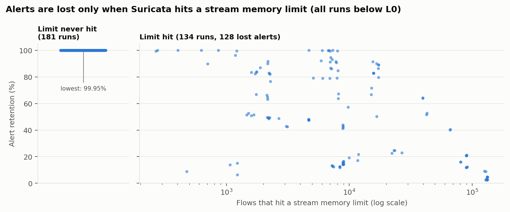

No run that stayed under both limits lost an alert (lowest retention 99.95 %). Almost every run that reached a limit
lost alerts. Watching for flows with `exception_policy` records is therefore a reliable warning sign; the two classic
drop counters were both zero in 22 of the 128 grid runs that lost alerts.

### 4.3 `ignore` keeps the most under exhaustion (RQ2)

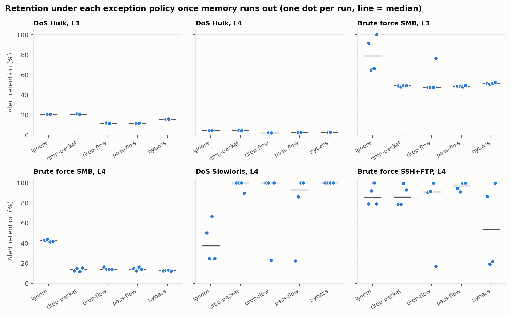

When memory runs out in every run, `ignore` keeps the most alerts. On SMB at L4 it kept 41.2-43.8 % on the endpoint key
and 76.9-77.6 % by host pair, against 11.7-16.4 % (16.9-25.4 % by host pair) for every other policy. By host pair, SMB
at L3 kept 100 % with `ignore` while every other policy lost alerts in all four runs. The flow-level policies stop
inspecting a whole flow once it reaches a limit, so they lose more.

### 4.4 Each pool protects different rules (RQ3)

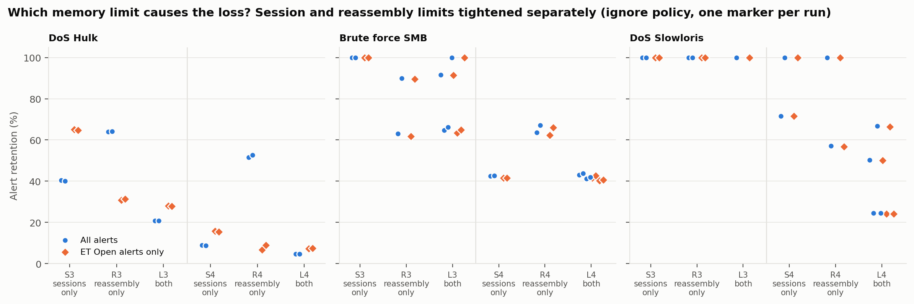

Tightening only the session limit (S4) removes exactly the 10 built-in `SURICATA STREAM` signatures that L4 removes:
untracked connections cannot show handshake anomalies. Tightening only the reassembly limit (R4) keeps the stream
checks but only 6.6-8.8 % of ET Open alerts, because content rules need the reassembled HTTP request.

### 4.5 A flood can hide a second attack below the defaults (RQ4)

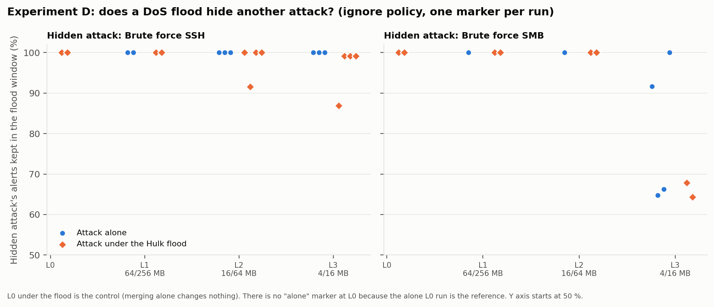

The SSH brute force was time-shifted into the Hulk flood and merged (`scripts/14_cover.py`). At the defaults nothing
was hidden. At L3 the SSH attack alone never lost an alert in 3 runs, but under the flood it lost alerts in all 4
(p = 0.029).

### 4.6 Lowering limits saves little memory

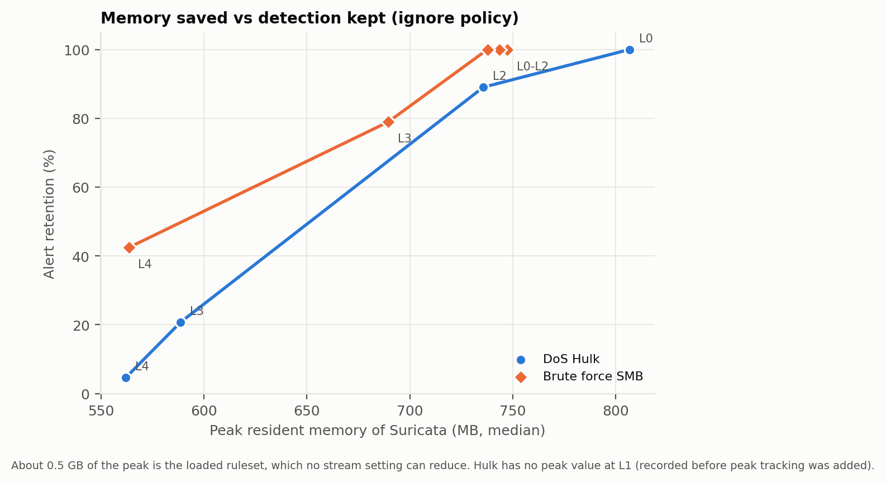

About 0.5 GB of Suricata's peak memory is the ruleset itself. Going from L0 to L4 saved about 245 MB on Hulk, at the
cost of 95 % of its alerts.

### 4.7 How much memory is enough: the sizing model (RQ5)

**Step A: held sessions are the true demand.** `scripts/15_peak_sessions.py` counts, from the L0 flow records, how
many TCP sessions Suricata holds at once. A session is held from its first packet until its flow times out (60 s after
a close, 600 s while established), because that is when its memory is freed.

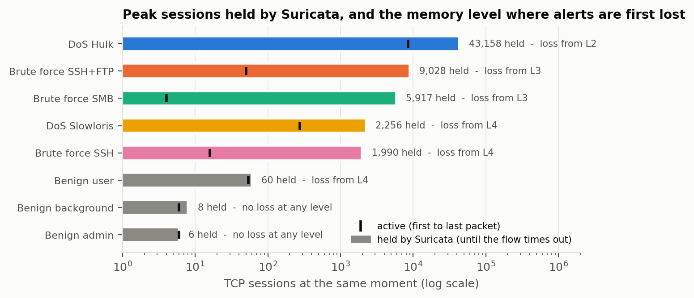

The held-session count sorts the captures into exactly the groups in which loss begins. Active sessions cannot: SMB
never had more than 4 active at once, yet it held 5,917.

**Step B: sweep each pool on its own** (96 runs, plus 42 repeats at the boundaries).

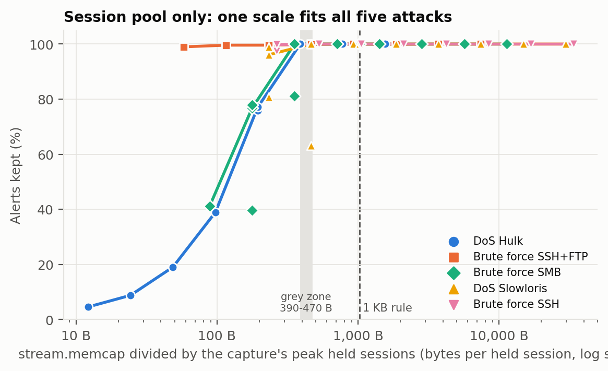

Divided by the held sessions, the session limit puts all five attacks on one scale: every loss happened at 465 bytes
per held session or less.

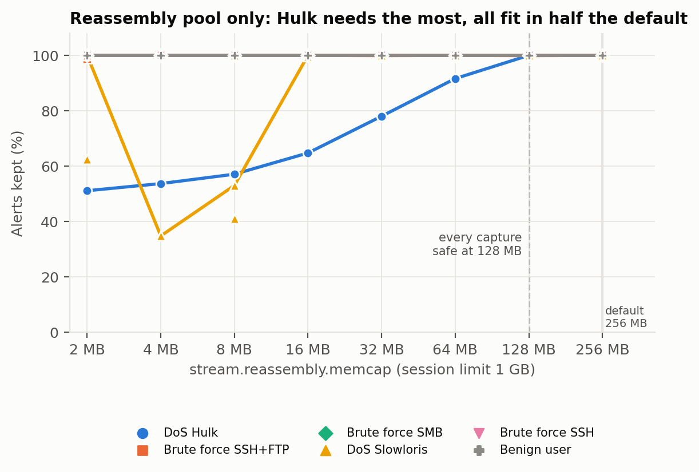

The reassembly pool depends on payload waiting to be reassembled, not on sessions: Hulk needs 128 MB, Slowloris
32 MB, SSH+FTP 4 MB, and SSH, SMB and the benign traffic lost nothing even at 2 MB.

**Step C: test the rule.** `stream.memcap = 1 KB x peak held sessions`, stated before the runs, three runs per attack.

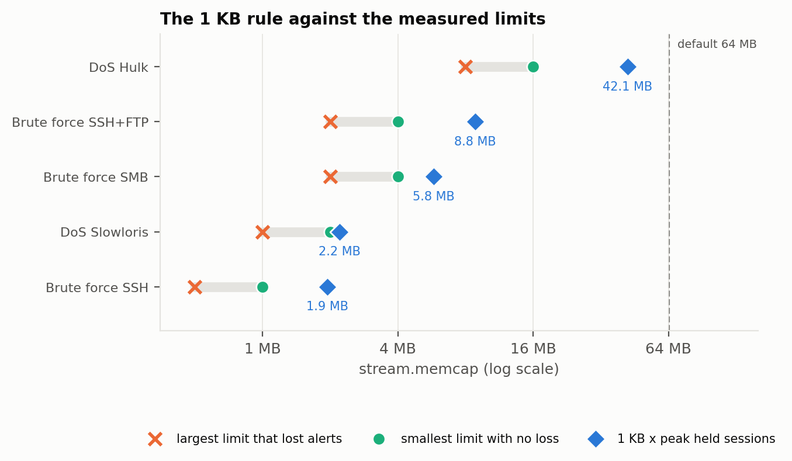

| Capture | Peak held | Session: lost at | Session: no loss from | 1 KB rule | Rule test (3 runs) | Reassembly safe |
|---|---|---|---|---|---|---|
| DoS Hulk | 43,158 | 8 MB | 16 MB | 42.1 MB | 100 %, no limit hit | 128 MB |
| Brute force SSH+FTP | 9,028 | 2 MB | 4 MB | 8.8 MB | 99.97 %, no limit hit | 4 MB |
| Brute force SMB | 5,917 | 2 MB (1 of 3) | 4 MB | 5.8 MB | 100 %, no limit hit | 2 MB |
| DoS Slowloris | 2,256 | 1 MB (1 of 3) | 2 MB | 2.2 MB | 100 %, limit hit in 1 run | 32 MB |
| Brute force SSH | 1,990 | 0.5 MB | 1 MB | 1.9 MB | 100 %, no limit hit | 2 MB |

**15 of 15 runs passed.** The rule needs 1.9-42.1 MB for these attacks, all below the 64 MB default, which is why the
defaults never lost an alert. **For operators:** measure peak held sessions from your own `eve.json` with
`scripts/15_peak_sessions.py`, set `stream.memcap` to at least 1 KB per held session, and keep at least 128 MB of
reassembly memory for traffic with HTTP floods.

### 4.8 Multi-threaded Suricata (RQ6)

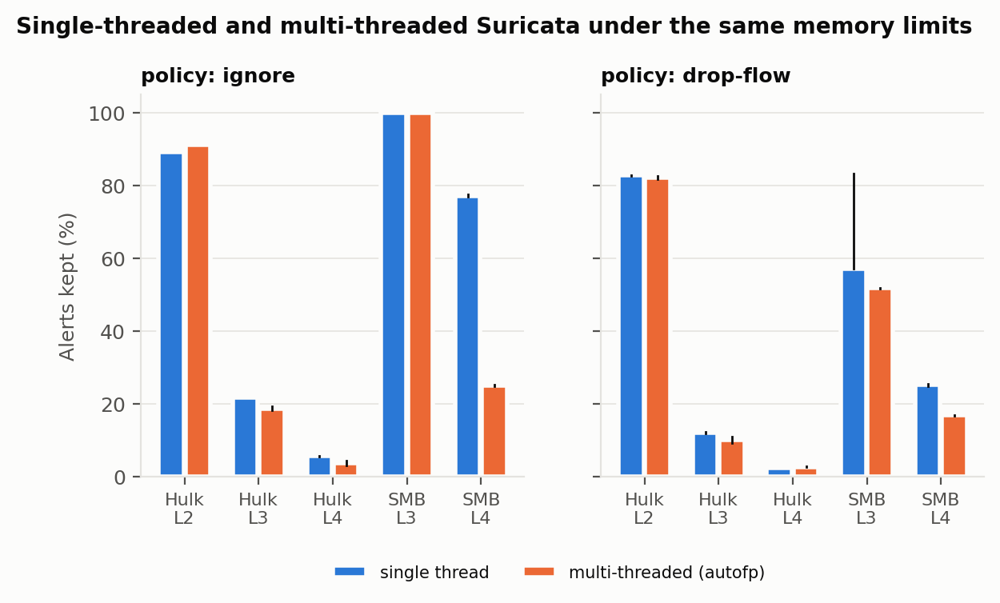

`--runmode autofp` raised the same alerts at L0 (6,114 of Hulk's 6,116 identical; all of SMB's 1,046 by host pair),
the same onset of loss, and the same policy ranking: `ignore` kept more than `drop-flow` in every cell in both modes.
Under the deepest exhaustion the size of the loss can differ (SMB at L4 with `ignore`: 25 % multi-threaded, 77 %
single-threaded), which is why sizing memory so that exhaustion never happens is the right goal.

### 4.9 Robustness of the alert key

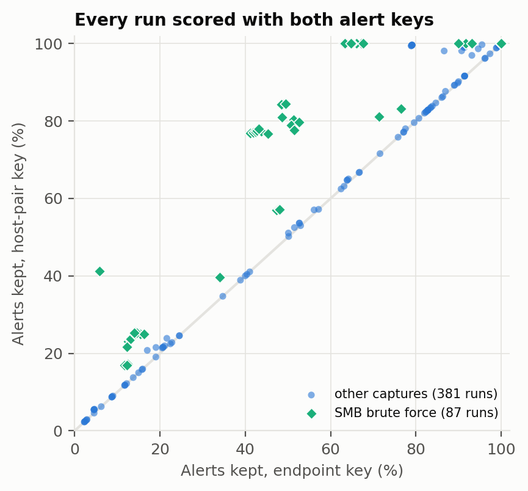

Rescoring all 468 constrained runs with the host-pair key changed the loss verdict of only 15 runs (14 SMB, 1
SSH+FTP), all from loss to no loss. Every conclusion holds on both keys.

### 4.10 Live demonstration and reproducibility

`./demo.sh` replays the Hulk flood with plenty of memory and with 1 MB / 4 MB, side by side, in about three minutes:

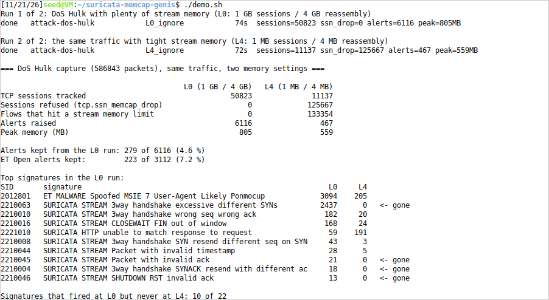

`./reproduce.sh` checks the image digest, ruleset hash and capture hashes, re-runs seven settings and compares them
with the recorded results. It printed `8 of 8 checks match / REPRODUCED` on the study VM and on a newly installed VM
with a clean clone:

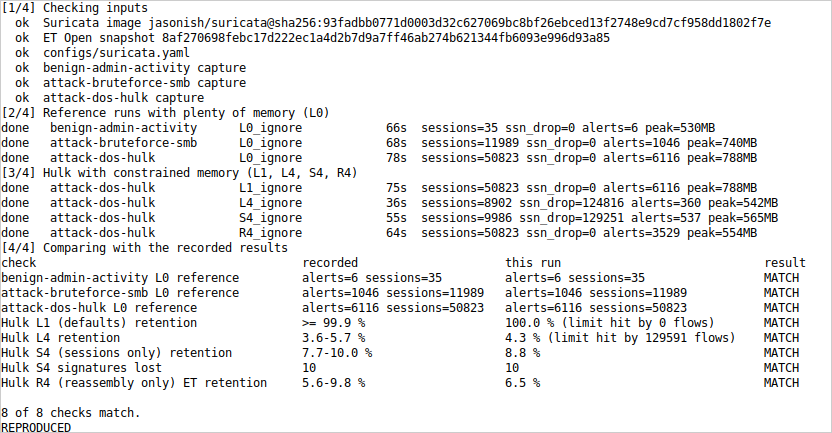

---

## 5. Reproduce it yourself

**Requirements.** Ubuntu 20.04 or later, Docker, Python 3, `wireshark-common` (for `capinfos`, `editcap`,
`mergecap`) and matplotlib (`pip3 install --user matplotlib`). Disk: the GeNIS archive (3.9 GB uncompressed; the 8
captures used are about 0.7 GB) plus the two merged captures (about 0.4 GB). **At least 4 GB of RAM**: the study ran
on 8 GB, `reproduce.sh` was verified on a fresh 4 GB / 3 CPU VM, and a 2 GB VM ran out of memory.

```bash
git clone https://github.com/AMSONI777/suricata-memcap-genis.git && cd suricata-memcap-genis
scripts/01_setup.sh            # pull the pinned image, download the GeNIS archive, check its MD5
scripts/02_extract_manifest.sh # extract the 8 captures, check them against docs/manifest.csv
./reproduce.sh                 # 7 runs, about 10 minutes; MATCH/MISMATCH per check, then REPRODUCED
./demo.sh                      # DoS Hulk at L0 and at L4, side by side, about 3 minutes
```

On Ubuntu 20.04 the download can fail with a certificate error, because the old CA bundle cannot verify Zenodo's
current certificate chain. Run `export WGET_OPTS=--no-check-certificate` before `scripts/01_setup.sh`; the MD5 check
still verifies the archive. Do not re-run `scripts/04_rules.sh`: it would download today's ET Open, which differs from
the snapshot used.

## 6. Full pipeline

| Script | Purpose |
|---|---|
| `scripts/01_setup.sh` | Pull the Suricata image, download and verify the GeNIS archive |
| `scripts/02_extract_manifest.sh` | Extract the 8 captures and record their size, packets, duration and SHA-256 |
| `scripts/03_feasibility.sh` | First check that the container runs and that the memory settings take effect; writes `configs/base_image.yaml` |
| `scripts/04_rules.sh` | One-time ET Open download (already done; snapshot kept in the repo) |
| `scripts/05_make_config.sh` | Build `configs/suricata.yaml` (eve.json limited to alert, flow and stats) and test it with the rules |
| `scripts/06_run.sh` | Run captures x levels x policies: `scripts/06_run.sh "<captures>" "<levels>" "<policies>"`. `REP=n` for repeats, `RUNMODE=autofp` for multi-threaded, levels `SP<size>` / `RP<size>` for single-pool sweeps and `SP<n>K` for an exact session limit in KB |
| `scripts/07_analyze.py` | Per-run counters and the first-run retention tables (`retention.csv`, `per_signature.csv`, `determinism.csv`) |
| `scripts/08_diff_alerts.py` | Alert-by-alert difference between two runs (used for the noise floor) |
| `scripts/10_all_runs.py` | Retention of every run against its capture's L0 run (`results/retention_all.csv`) |
| `scripts/11_separate_limits.py` | Separate-limits table (`results/separate_limits.csv`) |
| `scripts/14_cover.py` | Flood as cover: `build <capture>` makes the merged capture, `analyze` writes `results/cover.csv` |
| `scripts/09_figures.py` | Figures 1-6, A1 and the summary tables (`results/table_*.csv`) |
| `scripts/12_verify.py`, `scripts/13_demo_report.py` | Comparison and report steps of `reproduce.sh` and `demo.sh` |
| `scripts/15_peak_sessions.py` | Peak held and active TCP sessions per capture from the L0 flow records (`results/peak_sessions.csv`) |
| `scripts/16_sizing_sweep.py` | Single-pool sweeps, safe limits and the 1 KB rule test (`results/sizing_*.csv`) |
| `scripts/17_autofp.py` | Single-threaded against multi-threaded on both keys (`results/autofp.csv`) |
| `scripts/18_key_sensitivity.py` | Every run rescored with the endpoint and host-pair keys (`results/key_sensitivity.csv`) |
| `scripts/19_option_figures.py` | Figures 7-12 for the sizing model, the multi-threaded check and the key check |
| `scripts/patch_*.py` | One-off patches applied during the study, kept for the record |

The sizing and multi-threaded experiments were run with:

```bash
# Sizing sweeps (Step B), six captures, ignore policy
scripts/06_run.sh "attack-dos-hulk attack-bruteforce-smb attack-bruteforce-ssh-ftp attack-dos-slowloris attack-bruteforce-ssh benign-user-activity" \
  "SP512K SP1M SP2M SP4M SP8M SP16M SP32M SP64M RP2M RP4M RP8M RP16M RP32M RP64M RP128M RP256M" ignore
# Rule test (Step C): stream.memcap = peak held sessions in KB, e.g. Hulk
for R in "" 2 3; do REP=$R scripts/06_run.sh "attack-dos-hulk" "SP43158K" ignore; done
# Multi-threaded check
RUNMODE=autofp RUNS_SUB=results/runs_autofp SUMMARY_FILE=results/autofp_runs_summary.csv \
  scripts/06_run.sh "attack-dos-hulk" "L0 L2 L3 L4" "ignore drop-flow"
```

The full study takes several hours. Every run directory gets a `DONE` marker, so an interrupted batch resumes where
it stopped.

**Runs:** 550 in total. 506 on the 8 captures (8 references, 30 L0 repeats, 160 grid, 131 repeats, 24 separate-limit
runs, 96 sweep runs, 42 boundary repeats, 15 rule-test runs), 20 on the two merged flood captures, and 24
multi-threaded runs.

## 7. Repository layout

```
configs/             suricata.yaml used for every run, base_image.yaml from the image
data/raw/            the 8 GeNIS captures and the 2 merged flood captures (not in git; rebuilt by the scripts)
docs/                logs of every batch, ruleset and image records, capture manifest, analysis outputs
docs/archive/        pilot and week-9 notes from the planning phase (superseded, kept for the record)
figures/             all figures and the two terminal screenshots shown above
results/             run summaries and all result tables (per-run eve.json output is not in git)
results/runs_autofp/ multi-threaded runs (not in git)
rules/rules/         ET Open snapshot used for all runs
scripts/             the pipeline above
```

## 8. Scope

Offline replay of one dataset with one Suricata version and one ruleset snapshot. Offline reading removes packet
drops on purpose, so the results isolate memory limits; live capture and the `workers` runmode on a real interface are
the natural next step. `flow.memcap` and `defrag.memcap` were held fixed. The multi-threaded check covers the two
captures with the largest losses.

## Data

GeNIS: M. Silva, D. Pinto, J. Vitorino, J. Goncalves, E. Maia and I. Praca, "GeNIS: A modular dataset for network
intrusion detection and classification," *Data in Brief*, vol. 60, 2025, 111487
([doi:10.1016/j.dib.2025.111487](https://doi.org/10.1016/j.dib.2025.111487)), CC BY 4.0. ET Open rules by
Proofpoint Emerging Threats.
